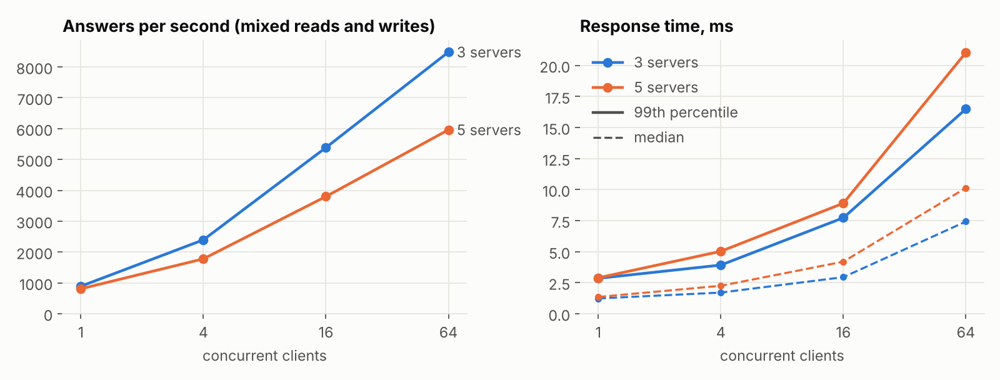
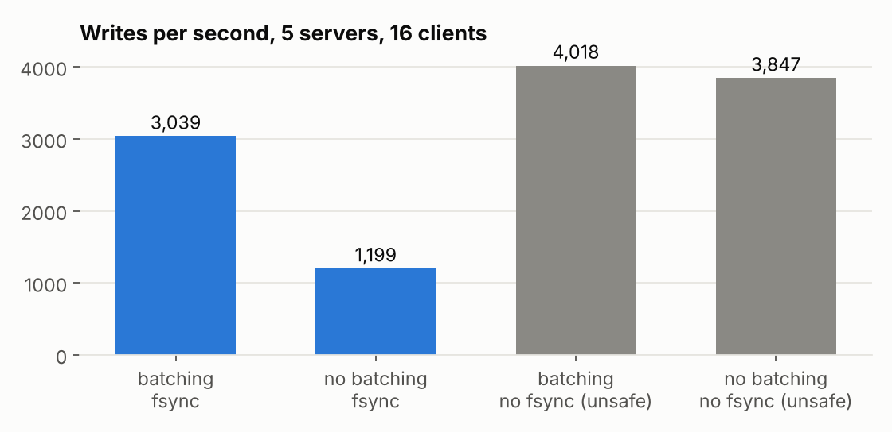
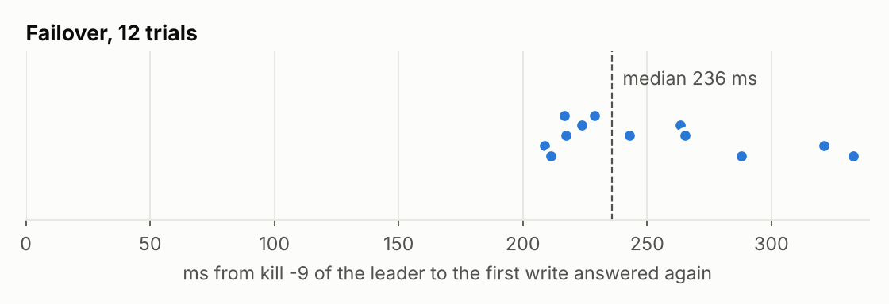

# Quorum benchmarks

Generated by `bench/report.py` from [`results.json`](results.json), which `cmd/quorum-bench` wrote on
2026-11-05. Rerun both to reproduce (see the end of this page).

**Machine.** 4 CPUs (AMD EPYC 7763 64-Core Processor), go1.24.13, one fsync of a small write takes 339 µs.
GitHub Actions runner (ubuntu-latest). All servers and all clients run on this one machine and talk over loopback HTTP, so
these numbers measure the software, not a network: a real deployment adds the round trip between
machines to every write.

**Correctness first.** Every load run below was recorded and checked by the linearizability checker:
455,266 answers in the load runs, all linearizable. A
fast wrong answer would not count.

## Throughput and response time



| servers | clients | mix | answers/s | median ms | p90 ms | p99 ms | unknown | linearizable |
|---:|---:|---|---:|---:|---:|---:|---:|---|
| 3 | 1 | mixed | 890 | 1.23 | 1.52 | 2.85 | 0 | yes |
| 3 | 4 | mixed | 2,394 | 1.70 | 2.38 | 3.92 | 0 | yes |
| 3 | 16 | mixed | 5,385 | 2.94 | 4.53 | 7.73 | 0 | yes |
| 3 | 64 | mixed | 8,483 | 7.42 | 11.28 | 16.49 | 0 | yes |
| 5 | 1 | mixed | 807 | 1.35 | 1.66 | 2.89 | 0 | yes |
| 5 | 4 | mixed | 1,778 | 2.25 | 3.37 | 5.03 | 0 | yes |
| 5 | 16 | mixed | 3,798 | 4.19 | 6.50 | 8.90 | 0 | yes |
| 5 | 64 | mixed | 5,961 | 10.13 | 15.84 | 21.04 | 0 | yes |

The best run here was 8,483 answers a second (3 servers, 64
clients). At 64 clients five servers answer 70% as many requests as three: each write is copied to four followers instead of two, and here they all share the same 4 CPUs. One client sends one request at a time, so its rate is set by response time;
more clients keep the leader's batches full.

## Reads against writes

| servers | clients | mix | answers/s | median ms | p90 ms | p99 ms | unknown | linearizable |
|---:|---:|---|---:|---:|---:|---:|---:|---|
| 5 | 16 | read | 8,521 | 1.45 | 2.66 | 4.28 | 1 | yes |
| 5 | 16 | mixed | 3,725 | 4.09 | 6.39 | 9.03 | 0 | yes |
| 5 | 16 | write | 3,043 | 5.10 | 7.03 | 9.52 | 0 | yes |

Reads skip the log: the leader confirms it is still the leader with one heartbeat round (ReadIndex)
and answers from memory, with no disk write.

## What batching and fsync cost



| batching | fsync | answers/s | median ms | p90 ms | p99 ms | unknown | linearizable |
|---|---|---:|---:|---:|---:|---:|---|
| on | on | 3,039 | 5.10 | 7.01 | 9.46 | 0 | yes |
| off | on | 1,199 | 13.10 | 15.60 | 20.09 | 0 | yes |
| on | off (unsafe) | 4,018 | 3.83 | 5.86 | 7.93 | 0 | yes |
| off | off (unsafe) | 3,847 | 3.98 | 6.17 | 8.47 | 0 | yes |

Every write must be on disk before it is acknowledged, or a power cut could lose it. Done one request
at a time that is one fsync per write: 1,199 writes a second. The leader
instead takes every request already waiting and saves them with one fsync:
3,039 a second, 2.5× more, with
the same guarantee. Turning fsync off is shown only to measure its cost; the server never runs that way
unless told to with `-no-fsync`.

## Failover



The leader was killed with `kill -9` 12 times while 8 clients wrote, and restarted a
second later. Time until a write sent after the kill was answered: median 236 ms,
fastest 209 ms, slowest 333 ms. Each follower waits a random 200-400 ms
without a heartbeat before it starts an election, and the first of the four to time out usually wins,
so most of this is that wait; the rest is a pre-vote round, a vote round and the new leader's first
commit. A shorter timeout would fail over faster but would also start needless elections on a slow
network, which is the trade-off the flaky-mobile scenario exists to test. History linearizable:
yes.

## Catching up after an outage

| down for | entries missed | back in step after | by snapshot | linearizable |
|---:|---:|---:|---|---|
| 2 s | 6,598 | 43 ms | yes | yes |
| 6 s | 20,176 | 42 ms | yes | yes |

A follower was killed while 16 clients kept writing, then started again. "Back in step" is when it had
applied everything the leader had committed at the moment it restarted; the time includes starting
the process and replaying its own log from disk. When it has missed more than the leader still keeps in
its log, the leader sends a snapshot of the whole store instead of the entries.

## The simulator

40 seeded runs per scenario, each 40 simulated seconds with 5 servers and 6 clients, reads
served with ReadIndex. Response times are in simulated milliseconds (one tick is 10 ms; message delays
are 1 to 12 ticks depending on the scenario).

| scenario | answers | per sim. second | median ms | p99 ms | leaders elected | power cuts | splits | failed runs |
|---|---:|---:|---:|---:|---:|---:|---:|---:|
| calm | 113,026 | 71 | 60 | 100 | 40 | 0 | 0 | 0 |
| flaky-mobile | 22,476 | 14 | 230 | 2310 | 40 | 0 | 0 | 0 |
| power-cuts | 98,207 | 61 | 70 | 680 | 251 | 929 | 0 | 0 |
| brownouts | 54,726 | 34 | 80 | 1440 | 1139 | 6595 | 0 | 0 |
| split-network | 102,289 | 64 | 70 | 390 | 191 | 0 | 544 | 0 |
| everything | 15,229 | 10 | 210 | 5040 | 392 | 726 | 480 | 0 |

A failed run would be any safety violation or any history that is not linearizable. Fewer answers
under flaky mobile data and "everything" is expected: lost messages mean retries and elections.

## Reproduce

```
go build -o bin/quorum-server ./cmd/quorum-server
go run ./cmd/quorum-bench -server bin/quorum-server -out bench/results.json
python bench/report.py
```

The `Bench` workflow in `.github/workflows/bench.yml` runs exactly this on a GitHub runner.
